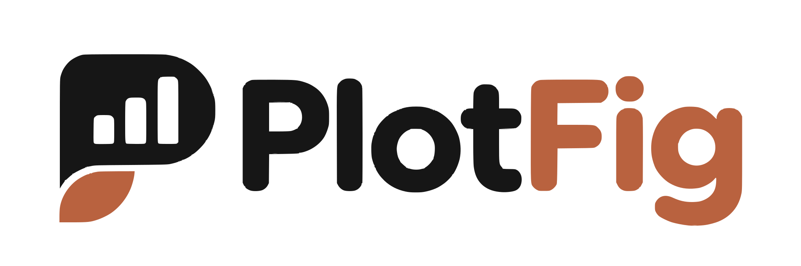
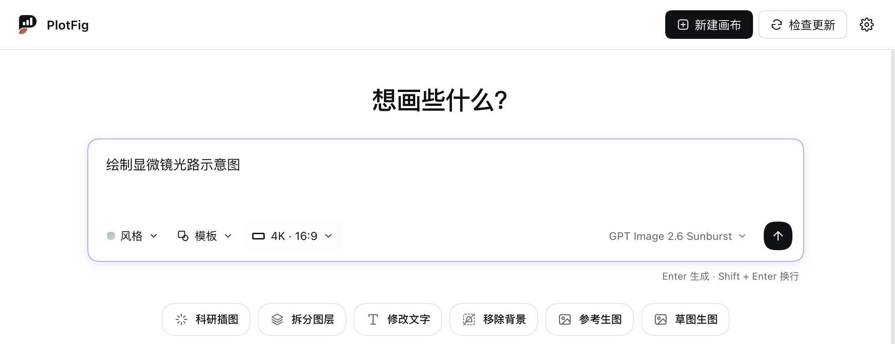
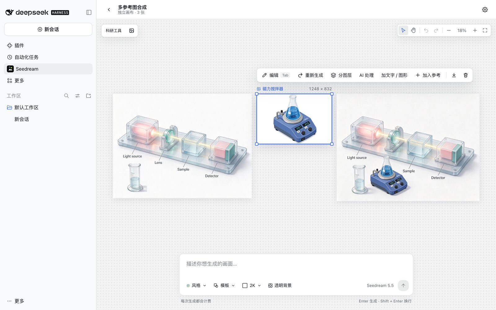

<p align="center">
  <picture>
    <source media="(prefers-color-scheme: dark)" srcset="docs/images/logo-dark.svg">
    
  </picture>
</p>

# PlotFig (dsh-plotfig)

An AI illustration plugin for researchers using DeepSeek Harness. Use Volcengine Ark **Seedream 5.5** (`doubao-seedream-5-5-261028`) for mechanism diagrams, method illustrations, graphical abstracts and presentation figures, then continue with layer editing, text changes and export. General image creation remains available. There are two kinds of canvas:

- **Conversation canvas**: one per conversation. Images generated in the conversation land on it, and it opens in the right Sidebar when a generation starts (Harness ≥ 0.2.2).
- **Standalone canvas**: created from the PlotFig panel with "新建画布". It belongs to no conversation.



## What it does

| You say or do | The plugin |
|---|---|
| "Draw a rainforest layering cross-section, textbook style" | Generates onto this conversation's canvas and opens it on the right |
| "Make 4 figures for this paper in one flat style: workflow, model, setup, results" | Plans four prompts and generates them one by one; a failed item does not stop the rest |
| Select an image, click **重新生成** | Generates again with the same settings in the same place; older versions stay switchable |
| Turn on **透明背景** and describe a device | A transparent PNG of just the subject, ready for figure assembly |
| **加入参考** on two images, then "put the device from 图2 into 图1" | Sends both images to the model |
| **AI 处理 → 局部重绘**, box a region, "add a measuring cylinder" | Redraws only inside the box; every outside pixel is kept |
| **分图层** | Splits into movable transparent layers with editable OCR text |
| Export | PNG, SVG, PDF and layered PSD with editable text |



## Install

```bash
dsh plugin --profile desktop add dsh-plotfig
```

Save an Ark API key under Settings → PlotFig (credential `ARK_API_KEY`). **测试连接** in settings lists Ark models with the saved key to confirm it works and Seedream 5.5 is enabled; it generates nothing and is not billed. Use `--profile web` for the web host. Saved canvases remain available for local editing and export without a key; model operations require one.

## Generating

- Use `/seedream <description>`, ask the assistant to draw, or type into a standalone canvas prompt box. The size menu offers seven aspect ratios at 2K, or a 1K/1.5K/2K tier that lets the model choose the shape.
- Conversation canvases share the native DSH composer: examples, edits and references append to the same Session's draft without submitting it. Opening a conversation canvas from the gallery returns to its conversation with the canvas on the right.
- The home page starts with a prompt box. A submission opens a new standalone canvas with the selected style and size. Six tool shortcuts and up to eight recent canvases sit below it; **全部画布** opens the full gallery.
- **重新生成** redoes a generated image with its original prompt, references, size and style, in the same place. Older versions are kept and switchable from the toolbar without a model call.
- For a set of different images, the assistant uses `seedream_generate_batch` (2–10 items, one billed image each, run in order; failures are reported, not retried).
- **加入参考** adds the selected canvas image to the prompt, up to 10 references. The main image (the one being edited or used for reference generation) is 图1 and the rest follow in order, so prompts can say "put the device from 图2 into 图1".
- **透明背景** generates a PNG with a transparent background, for icons, devices and figure parts. A result without transparency is kept with a warning.
- Repeated edits of one image request opaque output, as the Ark docs recommend for consistency, unless transparency is on.
- **风格** offers six appearance presets: flat, soft 2.5D, line art, naturalistic illustration, 3D rendering and ink with light washes. A preset is saved per canvas and adds appearance rules to later requests; choosing one makes no model call. **跟随描述** or `style: "auto"` leaves the prompt unchanged. Presets do not certify scientific accuracy or journal requirements.
- Import a PNG or JPEG up to 30 MB, 16000 px per side and 32 million pixels. Importing makes no model call; PNG bytes and alpha are kept.
- **模板** opens eight original local diagram templates (workflows, model architecture, cycles, timelines) in three palettes. Templates need no key and make no model call.

## Editing images (AI 处理)

Each operation saves its result as a new canvas image; the original stays intact. Requests are billed per output image and never retried automatically. Results that fail a check are marked for review and are not applied to a layer automatically.

- **去背景**: transparent cutout of the main subject; detached titles and panels are removed unless requested.
- **消除**: brush or rectangle masks with subtract, undo and redo. Every RGBA byte outside the mask is restored from the original; edges blend inward over 0–64 px (`feather`).
- **局部重绘** (inpaint): box 1–16 regions and describe what to draw. Regions are sent as Ark `<bbox>` tags and every pixel outside them is restored. The whole box is redrawn; drawing that crosses a box edge is cut off on restore and flagged.
- **扩图**: one side per pass, using a cropped edge reference and conservative alignment; the original rectangle is restored byte for byte. Several sides run in sequence (left, right, top, bottom), one billed image per side; if a later pass fails, completed passes are kept. Seams, mismatched edges, wrong aspect ratios, unfilled pixels and frame lines drawn beside the seam are flagged.
- **变清晰** (enhance): upscale and sharpen up to the ~4.62 MP model limit. The model can rewrite small text, so the result is compared with the source and changed areas are refilled from the upscaled original; those areas are slightly softer. Every enhanced result is marked for review.

`seedream_edit` exposes the same operations to the conversation agent. A repeated request id returns the saved result instead of billing again.

## Layers and text

- **分图层** splits an image into a locked background and transparent layers (2–100 outputs including the background, default 30, billed per output). You can box regions to separate; they are added to the prompt as `<bbox>` tags. `seedream_decompose` offers the same operation.
- Layers are edited on the main canvas: click, Shift/Cmd/Ctrl multi-select, marquee, drag, resize, rotate, merge and arrange. **详细编辑** adds text, shapes, alignment, stacking and OCR editing. **加文字 / 图形** creates an artboard without splitting. Edits autosave and support undo/redo.
- OCR text layers convert to locally editable rich text per line and style run. OCR font names follow Ark's 228-font list; each maps to a category fallback for display and a PostScript name for PSD.

## Export

- **画板 PNG** / **选中内容 PNG**, with transparency and off-artboard content.
- **SVG** for text-and-shape artboards without images or OCR.
- **PDF**: one lossless page at the artboard size (72 ppi), transparency as a soft mask. Text is not selectable.
- **分层 PSD**: named layers, order, opacity, hidden/locked state and a composite preview; added and OCR text stay editable. **PSD（文字转图片）** keeps text as pixels. Fonts are not embedded.

All exports are local and make no model calls.

## Billing and data

Each generation is billed per output image by Ark. Stopping a wait does not cancel a submitted request, and the result still appears on the canvas. Result URLs expire after 24 hours, so images are downloaded at once to `$DSH_HOME/seedream/canvases/<canvas id>/` (owner-only files). The watermark is on by default, matching Ark; it can be turned off in settings.

## Limitations

- 500 objects per artboard, 32 million pixels per PNG export; undo history lasts for the current run.
- AI results depend on the model. Pixel protection is exact; picture quality is not guaranteed. Expanding blank areas beside diagrams and tables is unreliable, cutouts lose glass-like translucency, combining several references can drop text labels, naturalistic and 3D presets look similar, and images in one batch are generated independently, so their look can differ even with the same style.
- PSD files have been checked in Photopea and Adobe Illustrator 2025, not in Photoshop. Fonts missing on the target machine are substituted.
- This is a beta release. Each AI operation was tested against the real Ark API, but on a limited set of samples. See [README_CN.md](README_CN.md) for the full Chinese guide and shortcuts.
