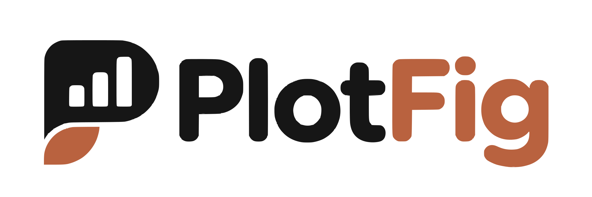
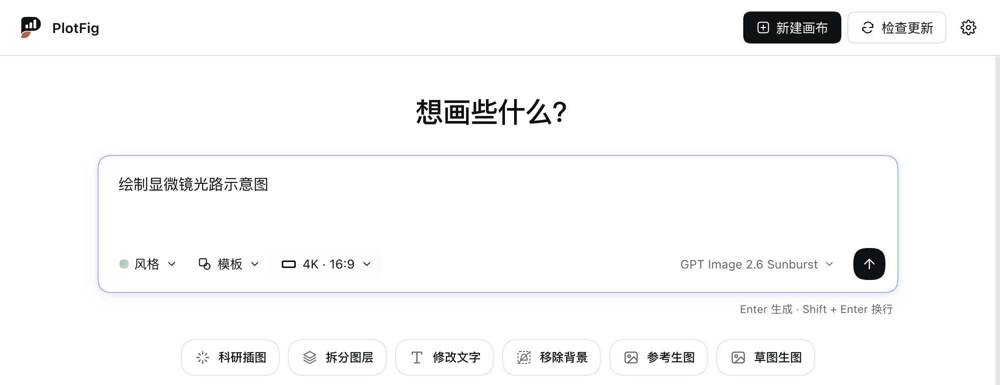
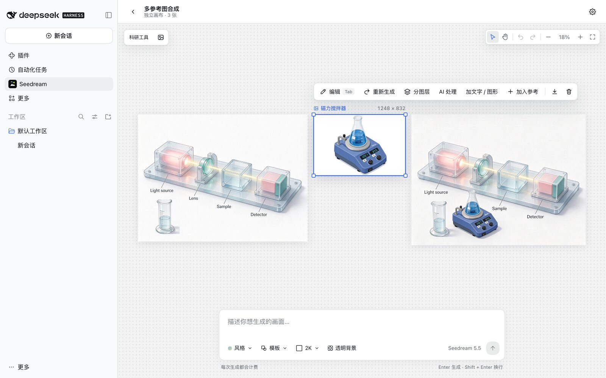
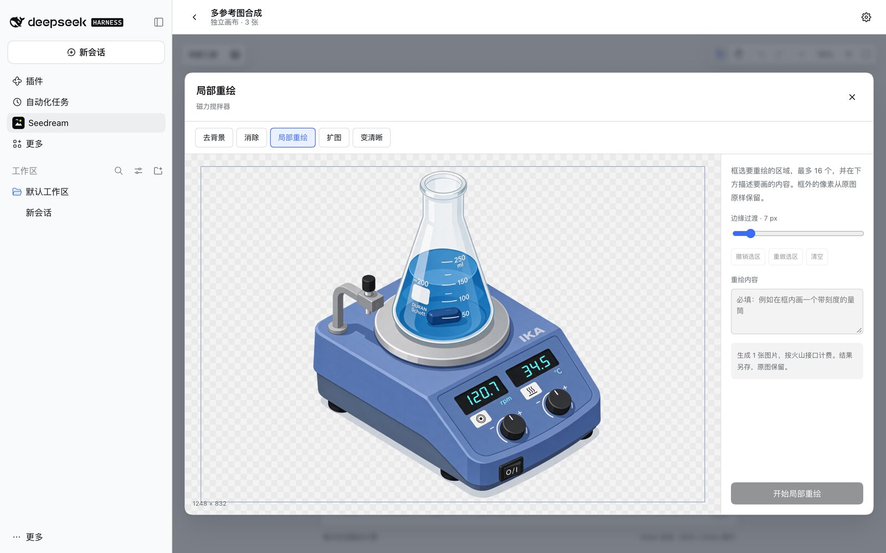

<p align="center">
  <picture>
    <source media="(prefers-color-scheme: dark)" srcset="docs/images/logo-dark.svg">
    
  </picture>
</p>

# PlotFig（dsh-plotfig）

面向科研工作者的 AI 插图创作插件。在 DeepSeek Harness 里使用 AI4Scholar 的绘图模型 生成机制示意图、方法架构图、图形摘要与汇报插图，再通过分层、改字和导出继续修改。也支持其他图片创作。画布有两种：

- **对话画布**：每个对话一块。对话里生成的图会自动放上去，右侧栏同时打开这块画布。
- **独立画布**：在 PlotFig 面板里新建，不属于任何对话，用来直接画图。



## 能做什么

| 你说或做 | 插件会做什么 |
|---|---|
| 「画一张雨林垂直分层剖面图，教材插画风格」 | 生成到这个对话的画布，右侧自动打开 |
| 「给这篇论文画 4 张图：方法流程、模型结构、实验装置、结果示意，统一扁平风格」 | 规划 4 个提示词，逐张生成；某一张失败不影响其他，最后报告成功几张 |
| 选中一张图点 **重新生成** | 用同样的描述再生成一次，放在原位置；旧版本保留，可在工具条上切回 |
| 打开 **透明背景** 后描述一个器件 | 生成只有主体的透明 PNG，方便拼进组图 |
| 选中两张图 **加入参考**，写「把图2的器件放进图1」 | 两张图一起发给模型合成 |
| 选中图片点 **AI 处理 → 局部重绘**，框一块区域写「画一个量筒」 | 只重画框内，框外像素原样保留 |
| 点 **分图层** | 拆成可拖动的透明图层，规整文字可直接改字 |
| 导出 | PNG、SVG、PDF、文字可编辑的分层 PSD |





透明原图在送入分层模型时会衬上白底。画布中保留原图，生成的前景图层保留透明通道。

## 安装

首次使用时先打开一次 DeepSeek Harness 桌面版以初始化配置，然后完全退出。运行以下命令从 npm 安装 PlotFig。

```bash
dsh plugin --profile desktop add dsh-plotfig@0.3.2
```

重新打开桌面版，在「插件 → 已安装插件」中启用 **dsh-plotfig**，再从侧栏打开 **PlotFig**。

点击首页右上角的 **检查更新**，可查看已安装版本和 npm 上的最新正式版。通过包名安装的 PlotFig 在支持更新的 DSH 中会显示 **更新到 v…**。点击即可在弹窗内升级。如果需要重启，弹窗会提示。旧版 DSH 可从插件管理器更新。

使用 0.3.0 或 0.3.1 时，点 PlotFig 首页右上角的 **检查更新 → 更新到 v0.3.2**。使用 0.2.1 或更早版本时，在「精选科研插件」的 PlotFig 卡片上点 **更新到 v0.3.2**。

PlotFig 的生图、编辑和分层只接受 AI4Scholar 签发的 Key。如果已在 dsh-ai4scholar 配置共享凭据 `AI4SCHOLAR_API_KEY`，安装 PlotFig 后即可复用。首次配置时，在「设置 → PlotFig」保存密钥，点「测试连接」可免费查看余额和 Seedream 配置状态。需要新密钥时，登录后可在「开放平台」创建。[前往 AI4Scholar 首页](https://ai4scholar.net/?src=dsh_plotfig)

Web 端使用 `--profile web`。未配置或移除 Key 后，已有画布仍可打开、本地编辑和导出；调用模型时需要配置 Key。

## 使用

### 常用工具与风格

- 「PlotFig」首页以输入框为主：填写描述，选择尺寸后直接生成到新画布。下方是 **科研插图、拆分图层、修改文字、移除背景、参考生图、草图生图** 六个小工具和最多 8 个最近画布。点击右侧 **全部画布** 查看完整列表；返回时保留描述、风格、尺寸和列表滚动位置。画布上方的「科研工具」可以对当前图片继续操作。
- 点击「最近画布」或「全部画布」卡片右下角的垃圾桶可删除单个画布。批量删除请进入 **全部画布 → 管理画布**，勾选或全选后点击 **删除所选**，核对名称再确认。
- 拆分图层与移除背景会先选择图片，再进入现有的参数确认窗口。修改文字优先打开已有图层画板及文字属性；普通图片需要先付费分层识别，后续改字在本地完成，没有可用 OCR 的文字仍是图片。
- 支持选择或拖入一张 **PNG / JPEG，最多 30 MB**。PNG 保留原始文件和透明度；JPEG 转为 PNG。导入不需要模型调用，单边不超过 16000 像素、总计不超过 3200 万像素。
- 参考生图与草图生图会带上所选图片和专用说明。独立画布保留图片标签，由你补全提示词后生成；对话画布追加到原生草稿，等待你发送。草图入口复用参考图能力，不包含手绘画板或矢量识别。
- 选中画布上的图片点 **加入参考**，可以把多张图一起放进输入框，最多 10 张。主图（编辑或参考生图的那张）始终是图1，其余按加入顺序编号，提示词里可直接写“把图2的器件放进图1”。每张参考图可单独移除。
- 在发送按钮左侧选择绘图模型。新画布默认使用 **Seedream 5.5**，也支持 AI4Scholar 画布中的 GPT Image 和 Nano Banana 系列。选择按画布保存，适用于新图和参考生图。对话画布可在顶部工具栏切换模型。
- 用 Seedream 连续编辑同一张图时，插件默认请求不透明输出，让多轮编辑的背景更一致。需要透明图片时可以打开「透明背景」。
- Seedream 输入框的 **透明背景** 开关：生成透明背景的 PNG，只保留主体，适合图标、器件和组图素材；可与参考图同时使用。模型未返回透明区域时保留结果并提示。
- 点击首页或独立画布输入框内的 **风格**，选择 **二维扁平、柔和立体、清晰线稿、自然写实插画、三维渲染、手绘淡彩**。风格独立于学科、对象、图型、视图、布局和配色。首页不常驻展示风格卡片；选择不会新建画布或发起生成。选择器用六张跨学科代表样图说明适配场景：实验器件、工程装置、生态剖面、材料结构和科学传播插图。旧 `journal` 值保留原行为，显示“简洁期刊（旧预设）”，不再列入六套基础画法。
- 风格按画布保存，刷新和重开后继续生效。它会将线条、配色、阴影和材质要求加入后续生图请求；选择本身不调用模型，也不修改已有图片。「跟随描述」关闭预设，单次工具请求也可用 `style: "auto"`。独立画布的普通「编辑」默认保留原图视觉风格，参考生图和草图生图使用所选预设。
- 风格要求与用户提示词合计最多 4000 个字符。风格名称不表示科学内容校验或期刊投稿规范。

### 在对话里画图

- 输入 `/seedream 画一张热带雨林垂直分层剖面图，教材插画风格`，或者直接让 AI 画图。
- 需要一组图时直接说数量和统一要求，AI 会调用批量工具 `seedream_generate_batch`，一次 2–10 张，逐张生成、每张计费一次；失败的那张会列出原因，不自动重试，其余照常保存。
- 开始生成时，右侧会自动打开这个对话的画布（需要 Harness 0.2.2 及以上），显示带计时的占位卡片。生成完成后，新图会放大显示并自动选中。
- 也可以随时点对话标题栏的 PlotFig 图标，打开画布。
- 对话画布只使用 DSH 原生输入框。点击示例、编辑或引用，只会追加到这个对话的草稿，由你修改后发送；已有文字、文件引用、引用块和附件由原生编辑器保留。
- 从「PlotFig → 全部画布」打开对话画布，会回到它所属的原生对话，同时展开右侧画布。每个对话的图片和草稿互不混用。

### 直接在画布上画图

- 点左侧栏「PlotFig」，在首页输入描述后发送，即可创建画布并开始生成；也可以点「新建画布」先打开空白画布。
- 在底部输入框写描述。Enter 发送，Shift+Enter 换行。
- Seedream 可在输入框左下角的尺寸菜单选比例（1:1、4:3、3:4、16:9、9:16、3:2、2:3，都是 2K），或者只选清晰度（1K、1.5K、2K，比例由模型决定）。GPT Image 和 Nano Banana 可分别选画幅比例和清晰度，菜单会显示当前模型支持的选项。
- 空画布会提供几个示例提示词，点一下就填进输入框。

### 选中图片后

- **重新生成**：用原来的模型、描述、参考图、尺寸和风格再生成一次，结果放在原位置，旧版本保留。工具条上的「‹ 1 / 2 ›」切换版本，切换不调用模型。删除当前版本时，自动显示剩下的最新版本。导入的图片、本地合成图和 AI 处理结果不提供重新生成。
- **编辑**（Tab）：对话画布会把图片引用放进原生对话输入框，接着描述修改要求并发送。独立画布会在自身输入框上方显示图片缩略图标签。生成的新图放在原图右边。
- **引用**：只有对话画布有。会把 `[PlotFig 图片 item:<id>]` 填进对话输入框，不会自动发送，AI 可以接着改这张图。
- **下载**原图，**删除**（会在工具条里确认）。

### 本地图形模板

- 点击首页、独立画布或对话画布里的 **模板**，可按「模型架构」「循环图」「时间线」筛选。以前保存的流程图可以从画布列表打开，继续编辑和导出。
- 可选的 6 个模板包括编码器与解码器、多路特征融合、研究迭代、反馈闭环、研究计划和里程碑。选好模板和配色（蓝绿、黑白或暖色），点击「使用」即可插入可编辑画板。
- 节点文字与图形一起移动。双击节点或在图层列表中选中节点，可改字、字号、文字颜色及填充描边。模板连线在节点移动、缩放或旋转后更新端点；可用「解除连接」改成独立箭头。新增箭头为自由箭头，不会自动吸附到节点。
- 支持撤销重做、自动保存，以及 PNG、SVG、分层 PSD 导出。SVG 仅用于纯文字与图形画板；含图片或 OCR 的画板继续使用 PNG／PSD。PSD 中节点以图形和可编辑文字组成的组保存，形状为像素层；SVG 保留矢量形状与文字，字体未嵌入。
- 模板内容是可替换的布局示例，不代表科研方法或报告规范。创建、编辑与导出全部在本地完成，无需 API Key，也不产生模型费用。已有图片画布继续兼容；新增图形类型需要本次构建或更新版本打开。

### 去背景、消除、局部重绘、扩图与变清晰

- 选中图片点 **AI 处理**，选择「去背景」「消除」「局部重绘」「扩图」或「变清晰」。在图层编辑器里，也可以对选中的、未锁定的图片层执行这些操作。
- **去背景**：生成透明 PNG，默认保留主要实体，移除独立标题、说明面板等；可补充说明需要保留的对象。局部修正有白底污染的半透明边缘，不削减透明度。AI 可能微调细节；若模型返回全不透明图片，会保留结果并提示检查效果。
- **消除**：涂抹或框选目标，使用「减选」修正范围，支持撤销、重做和清空。边缘过渡为 0–64 像素，只向选区内部生效；建议覆盖物体边缘和阴影，并为过渡留出余量。未选中的 RGBA 像素从原图原样保留。
- **扩图**：打开时默认向左扩展原图宽度的 15%，可点「向左 / 向右 / 向上 / 向下」切换方向，或分别填写四边的像素。单侧请求只参考相邻边缘，通过有条件的对齐和仅作用于新增区域的过渡改善衔接，蓝框内的原图文字、RGBA 像素完整保留。同时设置多侧（包括比例预设）时，按左、右、上、下的顺序逐侧扩展，后一步在前一步的结果上继续，每侧生成 1 张付费图片；某一步失败时保存已完成的部分并标记「部分完成」，不自动重试。对已经缩放或旋转的图层扩图时，原图部分仍留在原来的位置。检测到边缘不匹配、宽高比偏差或未填满新增区域时会标记「需检查」，单独保存结果，不自动替换图层；重新选中结果仍会显示提示。该检测不能保证所有场景都自然衔接。
- **局部重绘**：框选 1–16 个区域并描述要画的内容（必填），例如“放一个带刻度的量筒”。区域以 Seedream 交互编辑的 `<bbox>` 坐标写入请求，框外像素在本地从原图原样恢复，可设 0–64 像素的边缘过渡。模型若在框外也画了内容（常见于阴影），那部分会被还原、形成截断，插件会标记「需检查」，提示把框画大一些。
- **变清晰**：提高分辨率并锐化线条和文字，输出不超过模型上限约 460 万像素（例如 640×960 放大到 1755×2634）；已接近上限的图片无法再变清晰。透明图片保留原图轮廓。模型可能改写小字：插件把结果缩回原尺寸与原图比较（先模糊处理，避免把锐化当成改动），改动处按整词范围用原图放大还原，这些位置略模糊但内容正确，提示中注明还原比例。所有结果都标记「需核对」，另存到画布，不自动替换图层。
- 「AI 处理」使用 Seedream 5.5。每次点击「开始」按所示张数生成图片，按 AI4Scholar 积分计费，不会自动重试。关闭编辑窗口不取消结果保存。原图与结果分别保留；图层中的替换支持撤销，自动保存仍然生效。
- 对话工具 `seedream_edit` 支持去背景、消除、局部重绘（`inpaint`）、扩图和变清晰（`enhance`），可传同一画布的 `item:<id>` 引用、矩形选区、边缘过渡 `feather` 和扩图边距。同一请求标识与参数会复用已保存的结果，避免重复调用。
- 编辑结果最多 3200 万像素、单边不超过 16000 像素，宽高比在 1:16 到 16:1 之间。模型处理分辨率可能低于原图；消除、局部重绘和扩图在本地恢复受保护的原始像素。若本地处理失败，会保留模型原始结果并显示警告，不自动替换图层。

### 分图层与本地编辑

- 选中图片点 **分图层**，可在预览图上框选要单独拆分的区域（可多个，以 `<bbox>` 坐标写入说明），填写分层说明和最多输出图片数（2–100，默认 30，包含底图），再点「开始分层」。提交前显示最高预留积分。每次输入 2 积分，每张交付图片按实际像素收 3 积分（≤261 万像素）或 6 积分（超过 261 万像素），含底图与文字识别。完成后退回差额，失败全退。重开画布可按原任务编号取回结果。
- 分层结果另存为图层画板，原图不变，仍停留在主画布。直接点击可见图层即可选中、拖动、缩放或旋转，元素也可拖到画板外。底图默认锁定，拖动底图会移动整张画板。
- 不需要 AI 分层时，点 **加文字 / 图形**，直接以原图创建可编辑画板。这不会调用模型。
- 拖动控制点缩放或旋转，右侧可精确填写位置、大小、角度和不透明度。点击「文字」「矩形」「圆形」添加内容；双击新加的文字可编辑。
- Shift/⌘/Ctrl 点击，或从空白处拖动框选多个图层，悬浮工具条会出现 **合并图层** 和 **自动整理**。点 **图层** 打开当前画布里的列表，可选择、隐藏、锁定图层。按住空格或选择抓手工具平移画布。
- **详细编辑** 使用单行标题与左侧竖向悬浮工具条，工具菜单向右展开；撤销、重做与缩放集中在右下角。文字可直接添加，矩形/圆形在「添加形状」中，对齐、顺序、合并和删除在「更多操作」中；顶部提示图标可查看分层说明。窄窗口默认收起图层与属性面板，可从右上角展开。保留 OCR 和文字属性等精细操作。⌘/Ctrl+Z 撤销，⇧⌘/Ctrl+Z 重做，方向键微移，Shift+方向键移动 10 像素。
- 修改自动保存，重新打开继续编辑。若另一窗口已更新相同画板，会保留当前修改并提示冲突，可「另存副本」，不会自动覆盖对方。
- **画板 PNG** 按画板边界导出；**选中内容 PNG** 按选中内容边界导出，支持透明背景及移到画板外的元素。也可「保存为画布图片」，或引用到原生对话草稿继续让 AI 编辑。
- 本地移动、文字、形状、合并和导出均不产生模型费用。

### PDF 与分层 PSD 导出

- 导出菜单和画板工具条提供 **PDF**：单页，页面尺寸与画板一致（72 ppi，1 像素 = 1 pt），内容为无损图像，透明区域保留为软蒙版，文档标题使用画板名称。PDF 中的文字不可选中或编辑；需要可编辑文字请导出 PSD 或 SVG。
- 在图层编辑器的导出菜单选择 **分层 PSD**。保留独立图层、名称、前后顺序、透明度、隐藏和锁定状态，也保留画板外的图层内容。
- 新增文字导出为可编辑文字层；已转换的 OCR 文字按行和样式片段保留为文字层组。原本仍是图片的文字层不会自动转换。矩形、圆形和图片分别保留为独立像素层。
- **PSD（文字转图片）** 将文字也导出为独立像素层，适合优先保留当前显示效果。PSD 同时包含画板合成预览。
- 字体写入 PSD 时使用 PostScript 名称（OCR 识别出的 228 种字体都有对照），中英混排按字符保存字体回退。目标软件仍需具有对应字体；导出不嵌入字体，字体替换、基线和重排可能与画布有差异。需要固定外观时使用文字转图片模式。
- PSD 画板最多 3200 万像素、单边 16000 像素；图层及合成预览累计最多 8000 万像素。导出在本地完成，不调用模型。

### 直接修改识别出的文字

- 分层时会一并识别图中文字及其样式。列表中带 **T** 标记的文字图片可双击，或在属性中点 **编辑识别文字**，转换为本地可编辑文字。转换不会再次调用模型。
- 在「文字行」中选择一行，修改文案；若该行有多个样式片段，可选择片段后调整字体、颜色、粗体、斜体、下划线、删除线、阴影或半透明。文字过长时自动缩小到该行的范围内，也可展开「文字行位置与大小」调整行框。
- 图层已经移动、缩放或旋转时，转换会保留它的变换及叠放顺序。文本修改自动保存，并用于 PNG 导出、合并和引用回对话。
- **对照原图**只切换编辑器预览；导出仍使用修改后的文字。**恢复原图层**可恢复该文字层的原始 PNG，位置和缩放保持当前状态，这一步也能撤销。
- OCR 返回的是相似字体和近似样式（支持 228 种字体，包括 101 种中文字体和 127 种其他字体）。插件为每种字体记录类别（黑体、宋体、楷体、仿宋、圆体、标题、手写、等宽），画布按“原字体 → 已知别名 → 同类常见字体”的顺序显示；PSD 写入对应的 PostScript 名称，未知名称的字体按类别换成常见字体。缺少本机字体时仍会替换，字号由文字框估算。仅规整文字通常有 OCR；没有 OCR 或坐标不完整的旧图层会保留图片，并显示说明。

### 画布操作

| 操作 | 方式 |
|---|---|
| 平移 | 拖动空白处，或滚轮 / 触控板滑动 |
| 缩放 | ⌘/Ctrl + 滚轮，或右下角 − / + |
| 适应窗口 | ⌘0，或点右下角缩放比例 |
| 移动图片 | 拖动图片 |
| 撤销 / 重做移动 | ⌘Z / ⇧⌘Z |
| 删除选中图片 | Delete |
| 取消选中 | Esc |

## 计费与数据

- 每次生成使用 AI4Scholar 积分，插件只提交一次。点「停止等待」后，已发出的请求仍可能计费，生成完成后图片照样会出现在画布上。
- 生成结果会立即下载到 `$DSH_HOME/seedream/canvases/<画布 ID>/`，文件只有本人可读。对话画布的 ID 就是对话 ID，独立画布的 ID 以 `board-` 开头。
- 默认会在图片右下角添加「AI 生成」水印，可以在设置中关闭。默认尺寸也在设置里改。

## 当前限制

- PNG 导出上限 3200 万像素；画板最多 500 个对象。编辑撤销记录保留在当前运行期间，关闭应用后不保留历史。
- 右侧栏画布和自动打开需要 Harness 0.2.2 及以上。更早的版本可从左侧栏「PlotFig」预览对话画布；缺少原生草稿追加接口时，会复制提示词或图片引用，由你粘贴回原对话。
- AI 结果取决于模型，插件只保证受保护的原图像素不变，不保证画面效果：
  - 分图层可能有残留、缺字或补全误差，遮挡顺序可能需要手动调整；大号装饰文字可能没有 OCR，仍保留为图片。单张结果下载失败时会保存其余结果并显示提示，不会重新请求生成。
  - 消除范围内可能出现补全误差。
  - 扩图在说明图、表格旁的空白区域不可靠，模型可能画出无关内容；插件会标记「需检查」。
  - 去背景不保留玻璃、半透明外壳等材质的透明质感。
  - 局部重绘会整块重画框内内容；多参考图合成时，原图上的文字标注可能丢失，合成后请核对文字。
  - 变清晰可能改写小字，插件会用原图放大还原改动处，这些位置比其他区域略模糊。
  - 六种风格中「自然写实插画」和「三维渲染」的差别还不够明显。
  - 批量生成时各张图独立生成，即使指定同一风格，配色和外形也可能不一致。
- PSD 与 SVG 不嵌入字体，打开的软件缺少对应字体时会替换，基线和换行也可能与画布不同；需要固定外观时用「PSD（文字转图片）」。PSD 尚未在 Photoshop 中验收，已在 Photopea 和 Adobe Illustrator 2025 中检查文字层。
- PDF 内容为图像，文字不可选中。
- Seedream 的生图、改图、分层和积分结算已在 AI4Scholar 生产服务验证。其余八个模型在本次发布中通过了请求参数校验和模拟响应测试。
